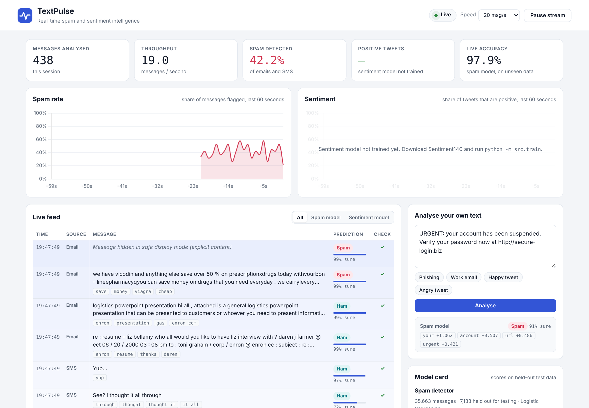
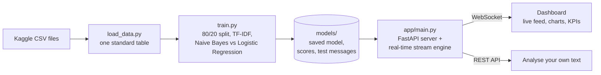

# TextPulse

**Real-time spam detection and sentiment analysis on 1.6 million messages, with a live web dashboard.**

TextPulse trains two text classifiers on public Kaggle datasets, then streams messages the models have never seen through them in real time. A live dashboard shows each prediction as it happens, the words that drove it, running accuracy against the true labels, and trend charts.



## Features

- **Two models in one system:** a spam detector for email and SMS, and a sentiment analyser for tweets.
- **Real-time stream:** a WebSocket pushes every prediction to the dashboard as it happens, at 5 to 200 messages per second.
- **Explainable predictions:** each result lists the words that pushed it toward its label.
- **Honest evaluation:** the stream replays only held-out test messages, and the dashboard checks every prediction against the real label live.
- **Model comparison:** Naive Bayes and Logistic Regression are trained on the same data, and the better one is kept automatically.
- **Bulk scoring benchmark:** scores every record in the datasets in batches and reports the throughput.
- **Analyse your own text** through the dashboard or the REST API.
- **Safe display mode** hides streamed messages that contain explicit content (real spam has plenty), so the dashboard is safe to present. Predictions still use the original text.
- **Works offline:** the charting library is bundled with the project, and light and dark themes follow your system setting.

## Results

Scores on held-out test data, which the models never saw during training.

| Task | Data | Test messages | Best model | Accuracy | Precision | Recall | F1 |
| --- | --- | --- | --- | --- | --- | --- | --- |
| Spam detection | 35,663 emails and SMS (after removing duplicates) | 7,133 | Logistic Regression | **97.95%** | 98.08% | 97.11% | 97.59% |
| Sentiment analysis | 1,600,000 tweets | 320,000 | _run `python -m src.train`_ | | | | |

Spam accuracy by source: **email 98.4%**, **SMS 95.1%**. SMS is harder because the messages are short and full of slang.

## How it works



1. **Clean** each message: lowercase it, turn links into `url` and @names into `user`, and remove punctuation and digits.
2. **Vectorise** with TF-IDF over single words and word pairs, so phrases like "not good" are captured.
3. **Train** Naive Bayes and Logistic Regression, compare them on the test set, and keep the one with the higher F1 score.
4. **Stream:** the server picks unseen test messages, classifies them one at a time, and pushes each result to every open dashboard.
5. **Explain:** both algorithms are linear, so each word's contribution (TF-IDF value × word weight) explains the prediction exactly.

New to the code? [docs/HOW_IT_WORKS.md](docs/HOW_IT_WORKS.md) walks through every file in plain language.

## Quick start

You need Python 3.10 or newer. On Windows, run these commands in **Anaconda Prompt** or **PowerShell**.

```bash
# 1. Get the code and install the libraries
git clone https://github.com/sgoel2718/ml-30-days.git
cd ml-30-days/projects/textpulse
python -m venv .venv
.venv\Scripts\activate          # Windows
# source .venv/bin/activate     # macOS / Linux
pip install -r requirements.txt

# 2. Download the datasets into data/ (see data/README.md if Kaggle asks you to sign in)
python -m scripts.download_data

# 3. Train both models (about 5 to 10 minutes on a laptop, mostly for the 1.6M tweets)
python -m src.train

# 4. Optional: score every record and measure the speed
python -m scripts.benchmark

# 5. Start the dashboard, then open http://127.0.0.1:8000
uvicorn app.main:app
```

Run the tests with `python -m pytest`.

## API

| Method | Path | Purpose |
| --- | --- | --- |
| `GET` | `/` | The dashboard |
| `GET` | `/api/status` | Loaded models, live totals, stream state and recent messages |
| `GET` | `/api/metrics` | Test scores from training, plus the benchmark |
| `POST` | `/api/analyze` | Analyse your own text: `{"text": "..."}` |
| `POST` | `/api/stream/pause` · `/resume` | Pause or resume the live stream |
| `POST` | `/api/stream/speed` | `{"messages_per_second": 50}`, from 1 to 200 |
| `WS` | `/ws/live` | Receives every prediction as it happens |

Interactive API documentation is generated automatically at `http://127.0.0.1:8000/docs`.

## Project structure

```
textpulse/
├── app/
│   ├── main.py            FastAPI server, REST API and real-time stream engine
│   └── static/            dashboard: index.html, style.css, app.js, bundled Chart.js
├── src/
│   ├── config.py          every path and setting in one place
│   ├── clean_text.py      text cleaning
│   ├── load_data.py       reads the Kaggle files into one standard table
│   ├── train.py           trains, compares, evaluates and saves both models
│   └── analyzer.py        predicts and explains a single message
├── scripts/
│   ├── download_data.py   fetches the datasets
│   └── benchmark.py       scores every record and measures speed
├── tests/                 automated tests (pytest)
├── data/                  datasets go here (not committed; see data/README.md)
├── models/                trained models and scores (created by training)
└── docs/                  beginner guide and screenshot
```

## Limitations

- **Old training data.** The Enron emails are from 1999 to 2005, and the SMS messages from around 2011. Modern phishing uses different wording, so accuracy on today's spam would be lower.
- **Out-of-domain text.** The spam model learned from email and SMS. It can be unsure about tweet-style text, and the dashboard marks predictions below 65% confidence as "low".
- **Sentiment labels come from emoticons.** Sentiment140 was labelled automatically using :) and :( and has only positive and negative classes, with no neutral.
- **Bag-of-words models** ignore word order beyond word pairs. Transformer models such as BERT, covered later in the course, handle context and sarcasm better.

## Data and credits

- **Sentiment140:** Go, Bhayani & Huang (2009), *Twitter Sentiment Classification using Distant Supervision*. [Kaggle](https://www.kaggle.com/datasets/kazanova/sentiment140)
- **SMS Spam Collection:** Almeida, Gómez Hidalgo & Yamakami (2011), UCI Machine Learning Repository. [Kaggle](https://www.kaggle.com/datasets/uciml/sms-spam-collection-dataset)
- **Enron-Spam:** Metsis, Androutsopoulos & Paliouras (2006), preprocessed by Marcel Wiechmann. [GitHub](https://github.com/MWiechmann/enron_spam_data)
- **Chart.js** 4.4.1, MIT licence (bundled in `app/static/vendor`).

Built by Shubham as part of a 30-day machine learning programme alongside the PG Certification in AI/ML at IIIT Hyderabad.
